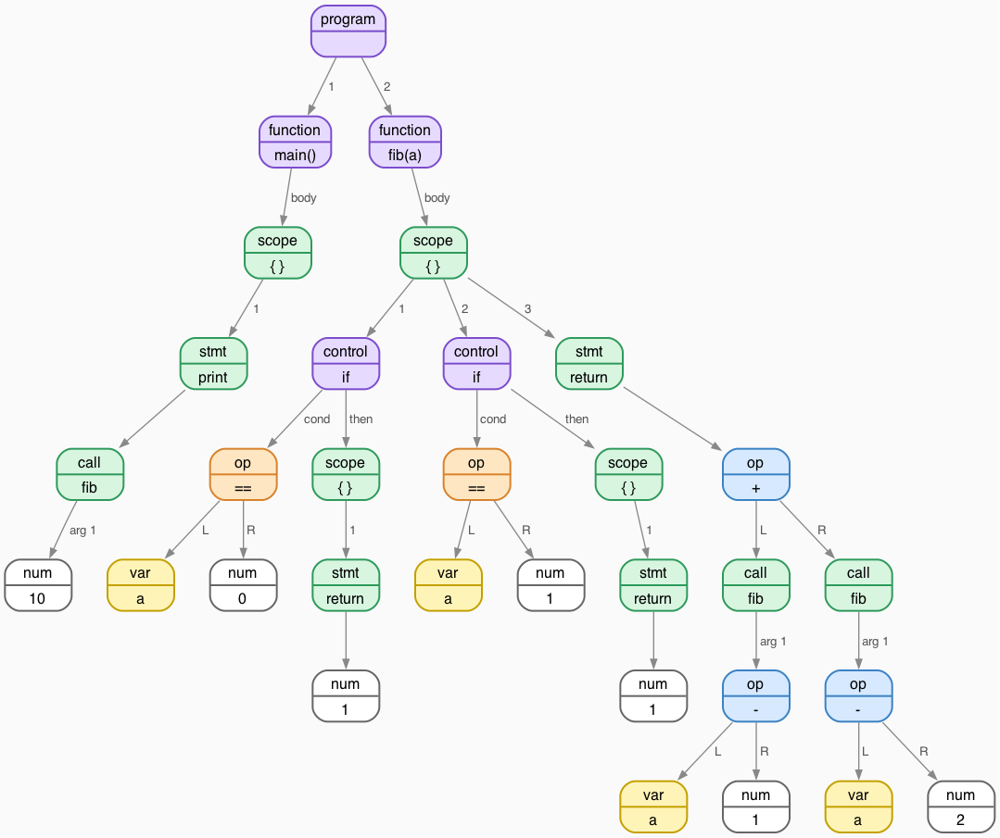

# Lang



## Возможности языка

- Функции с параметрами и рекурсией, точка входа — `main()`
- Целочисленный тип (`std::int64_t`)
- Арифметика: `+`, `-`, `*`, `/`, `%`
- Сравнения: `<`, `>`, `<=`, `>=`, `==`, `!=`
- Присваивание переменных (`x = expr;`)
- Ветвления `if` / `else` и цикл `while`
- Вывод через `print(...)`, возврат значения через `return`
- Блочные комментарии `/* ... */`
- Области видимости и фреймы вызовов (локальные переменные функции не видны снаружи)

## Пример

Файл `input.txt`:

```
main() {
    print(fib(10));
}

fib(a) {
    if (a == 0) {
        return 1;
    }

    if (a == 1) {
        return 1;
    }

    return fib(a - 1) + fib(a - 2);
}
```

Результат: `89`.

## Грамматика

```
G          ::= FUNCTION_D+
FUNCTION_D ::= V "(" [ E {"," E}* ] ")" "{" OP* "}"

OP         ::= RETURN | SCANF | PRINTF | WHILE | IF | CALL | ASSIGN

RETURN     ::= "return" E ";"
PRINTF     ::= "print" "(" E ")" ";"
CALL       ::= V "(" [ E {"," E}* ] ")" ";"
WHILE      ::= "while" "(" CONDITION ")" BODY
IF         ::= "if" "(" CONDITION ")" BODY [ "else" BODY ]
CONDITION  ::= E [ ("<=" | "<" | ">=" | ">" | "==" | "!=") E ]
BODY       ::= "{" OP* "}"

E          ::= T ([+-] T)*
T          ::= P ([*/%] P)*
P          ::= "(" E ")" | CALL | V | N

V (Identifier) ::= имя переменной или функции
N (IntLiteral) ::= целое число
```

## Сборка и запуск

```bash
cmake -S . -B build
cmake --build build
```

Запускать нужно из корня репозитория, потому что программа читает файл `input.txt` из текущей директории:

```bash
./build/interp
```

После запуска интерпретатор:

1. разбирает `input.txt`;
2. сохраняет `ast.dot` и `ast.png` в текущую директорию (нужен `dot`);

## Тесты

```bash
cmake --build build --target unit_tests
cmake --build build --target interpreter_unit_tests
ctest --test-dir build --output-on-failure
```

- `unit_tests` — тесты лексера и парсера
- `interpreter_unit_tests` — тесты интерпретатора на вручную собранных деревьях
